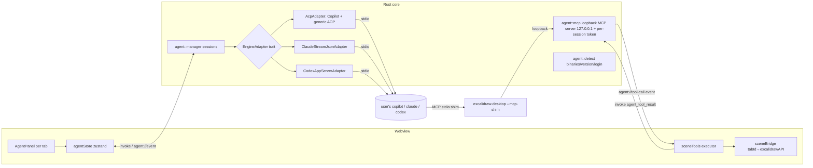

# AI agent integration — "Bring your own agent"

> Design contract for the AI features (requirements §4.9, plan milestones AI-0…AI-6). Status lives in `docs/status.md`.
> The app never holds AI credentials: it drives the user's **locally installed, already signed-in** agent
> (GitHub Copilot CLI, Claude Code, or OpenAI Codex) and exposes the canvas to it as MCP tools.

## Decisions

| #     | Decision                                                                                                                                                                                                                                                                                     |
| ----- | -------------------------------------------------------------------------------------------------------------------------------------------------------------------------------------------------------------------------------------------------------------------------------------------- |
| D-AI1 | v1 supports **Copilot CLI, Claude Code, and Codex** behind one shared engine layer.                                                                                                                                                                                                          |
| D-AI2 | Primary surface: **docked right-side chat panel, one conversation per tab**.                                                                                                                                                                                                                 |
| D-AI3 | Agent edits **apply live**; each turn is one undoable step, plus a **Revert turn** button.                                                                                                                                                                                                   |
| D-AI4 | Canvas-only by default; optional per-conversation **Attach folder** grants read-only access. Engine built-in shell and file-write tools are always disabled.                                                                                                                                 |
| D-AI5 | Per-engine toggle **"Use my agent's MCPs, skills & plugins"** (default **on**). Tools from those sources that aren't known read-only need in-app approval, with "allow for this conversation".                                                                                               |
| D-AI6 | Claude Code is **bring-your-own-binary**. If `claude` is installed and logged in, we use it. We never read, store, or proxy credentials. Settings shows a one-line "your Claude/Copilot/OpenAI terms apply" note, and legal review is a release-gate item (T3 Code ships this same pattern). |
| D-AI7 | **No API keys anywhere.** Remove `openAiKey` and migrate it out of `settings.json`. SEC-3 becomes "the app stores no AI credentials".                                                                                                                                                        |

## Research summary (what drives the design)

- **Copilot CLI:** `copilot --acp --stdio` is a native ACP server (public preview), with NDJSON JSON-RPC
  (`initialize`, `session/new {cwd, mcpServers}`, `session/prompt`, `session/update`,
  `session/request_permission`, `session/cancel`). Tool filters are set per process:
  `--available-tools` / `--excluded-tools`, `--deny-tool shell/write`, and `--no-custom-instructions` /
  `--disable-builtin-mcps` when the "my MCPs" toggle is off. The login lives in the OS credential store.
  There is no `auth status` command, so we detect an auth error on the first `session/new`. Each prompt
  uses a premium request. The Copilot SDK (MIT, now has a Rust crate) is an alternative; ACP is simpler
  and doesn't load the runtime in-process.
- **Claude Code:** `claude -p --input-format stream-json --output-format stream-json --verbose` runs a
  long-lived bidirectional session. It also supports `--mcp-config`, `--disallowedTools
Bash,Edit,Write,NotebookEdit`, `--permission-prompt-tool` (routes approvals to our own MCP tool),
  `--append-system-prompt`, and `--resume`. The ACP adapter (`agentclientprotocol/claude-agent-acp`)
  needs Node plus the Agent SDK, so a native stream-json adapter avoids a Node dependency. Strip
  `ANTHROPIC_API_KEY` from the child env so the user's own login is used and billing doesn't switch
  silently.
- **Codex:** `codex app-server` speaks JSON-RPC over stdio and handles threads and approval requests
  (it is what the Codex IDE extension uses, and what T3 Code uses). It is marked experimental, so we
  pin a minimum version. `codex exec --json` is the fallback. `--sandbox read-only`, `-c
mcp_servers.excalidraw.*` overrides, and the login in `~/.codex/auth.json` or the keyring (we only
  check that it exists). `codex-acp` also exists.
- **ChatGPT desktop app / Copilot desktop app:** neither exposes an API another app can drive. We say so
  in the UI and docs ("use Codex CLI with your ChatGPT sign-in").
- **Excalidraw 0.18.1:** everything we need is public API: `updateScene({captureUpdate: IMMEDIATELY})`,
  `newElementWith`, `convertToExcalidrawElements`, `restoreElements({repairBindings})`, `exportToBlob`,
  and `hashElementsVersion`. `@excalidraw/mermaid-to-excalidraw` 2.2.2 is already a transitive
  dependency and is CSP-safe (no eval). `TTDDialog onTextSubmit` can be backed by our agent (it returns
  Mermaid, not streamed). Pitfalls: bump element versions, tombstone deletes (or collab won't sync them),
  arrows to _existing_ shapes need manual bindings, block edits in collab **viewer** tabs, and call
  `markDirty` explicitly.

## Architecture

- **Canonical event model** (the same pattern as T3 Code's `ProviderRuntimeEvent`): `TurnStarted`,
  `TextDelta`, `ThinkingDelta`, `ToolCall{started|updated|completed}`, `PermissionRequest`, `Plan`,
  `TurnEnded{stopReason, usage?}`, `Error{kind: notInstalled|notLoggedIn|orgDisabled|crashed|...}`. Each
  adapter translates its engine's protocol into these events. The webview only sees the canonical events.
- **Canvas tools via MCP served by the app:** an axum `/mcp` (streamable HTTP) on 127.0.0.1 with a
  random port and a per-session bearer token. Not every engine supports HTTP MCP, so we pass all of them
  a **stdio shim**: the app's own binary started with `--mcp-shim` (token in env), which proxies stdio to
  the loopback server. Tool calls are forwarded to the webview executor, which owns the excalidrawAPI.
  Rust waits for the result with a timeout.
- **Process hygiene:** resolve binaries from a candidate list, then the login-shell PATH
  (`$SHELL -lic`) on macOS or `where` + PATHEXT on Windows. Users can override the path. Handle `.cmd`
  shims via `cmd /c` or by resolving the real target. Use `CREATE_NO_WINDOW`; a Windows Job Object
  (kill-on-close) and a POSIX process group plus `killpg` for tree teardown. Send `session/cancel`
  before killing. Each conversation runs in a scratch cwd under `<appData>/agent/<tabId>`, or in the
  attached folder.
- **Sandboxing per engine** (always on): Copilot gets `--excluded-tools bash,powershell,edit,create,apply_patch`
  and `--deny-tool shell --deny-tool write`, never `--allow-all*`. Claude gets `--disallowedTools
Bash,Edit,Write,NotebookEdit,MultiEdit` and `--permission-prompt-tool mcp__excalidraw__approve`.
  Codex gets `--sandbox read-only` and on-request approvals. Our own canvas tools are pre-approved. Any
  other permission request becomes an inline approval card (Allow once / Allow for this conversation /
  Deny).
- **"Use my MCPs, skills & plugins" OFF:** Copilot gets `--disable-builtin-mcps`,
  `--no-custom-instructions`, and only our MCP server. Claude gets `--strict-mcp-config`. Codex gets
  `-c mcp_servers={}` plus ours.
- **Privacy, CSP and capabilities:** the webview makes **no** new network requests, the CSP is
  **unchanged**, and no new Tauri plugin capability is needed (only custom commands). Network traffic
  comes from the user's agent process, to its own provider, only after the AI master toggle is on, the
  engine is enabled, and the user sends a prompt. The first use per engine shows a disclosure: "Prompts,
  the canvas content the agent reads, and attached-folder files are sent to <provider> under your
  <engine> account." The Playwright privacy test asserts that with AI off, no engine process starts and
  no requests are made.

## Agent tool set (served by our MCP)

Every tool takes an optional `tabId` (default: the active tab). Read tools return a `revision`. Edit
tools accept `expectedRevision` and are rejected if the scene changed since that read.

| Tool                | What it does                                                                              |
| ------------------- | ----------------------------------------------------------------------------------------- |
| `list_tabs`         | Lists open tabs                                                                           |
| `get_scene_summary` | Compact element rows plus bounds, with pagination by bbox, ids, or cursor                 |
| `get_selection`     | Returns the current selection                                                             |
| `get_elements`      | Returns elements by id                                                                    |
| `render_canvas_png` | Renders all / viewport / selection as a PNG ≤1280px for the model to look at              |
| `add_elements`      | Adds skeleton-format elements; agent-chosen ids are checked for collisions                |
| `update_elements`   | Updates elements, limited to an allowlisted set of fields; re-routes bound arrows         |
| `delete_elements`   | Tombstones elements and cascades to bound text and arrows                                 |
| `connect`           | Draws an arrow between existing shapes using manual bindings                              |
| `add_mermaid`       | Converts Mermaid via mermaid-to-excalidraw; reports when the result fell back to an image |
| `arrange`           | align / distribute / grid / group / z-order                                               |
| `set_viewport`      | Moves the viewport, without an undo step                                                  |
| `apply_ops`         | Batches several edits into one undo step                                                  |
| `approve`           | Internal tool, used only for Claude's permission prompts                                  |

A system prompt (appended) explains the coordinate system, the tool workflow (summary, then render,
then edit), and the style defaults.

## UX

- **Settings → AI** replaces the OpenAI section:
  - Master toggle, default off.
  - One card per engine showing detected path and version and login state, with "Re-detect", "Custom
    path…", a copyable "How to sign in" command (`copilot login` / `claude` then `/login` /
    `codex login`), an Enable checkbox, the "Use my MCPs, skills & plugins" toggle, and a default model
    (when the engine reports a model list).
  - Default engine.
  - A terms note.
- **Agent panel**, toggled from the toolbar button, View → AI Panel, or ⌘/Ctrl+Shift+A:
  - Docked right, resizable, one panel per tab. The header has an engine and model picker plus New
    conversation.
  - The transcript renders Markdown with sanitizing, collapsible "thinking", and tool chips such as
    "Added 12 elements" (click to select them on the canvas).
  - Inline approval cards, a Stop button, and **Revert turn** on each completed turn.
  - Context chips: auto "Selection (n)", "Attached folder" (picked via a dialog, read-only, removable),
    and "Snapshot" to send a render.
  - Quick actions on empty state: _Diagram from description_, _Explain selection_, _Tidy layout_,
    _Convert to Mermaid_, _Diagram this folder_ (needs Attach).
  - Empty and error states for each failure: not installed (with link to install docs), not logged in,
    org disabled, engine crashed (Retry), and a viewer tab in a live session (agent disabled).
- **Revert turn:** at turn start we snapshot the versions of every element the turn touches. Revert
  writes them back with bumped versions and tombstones anything the turn added, in one undoable,
  collab-safe `updateScene`. It is available only until the user edits those same elements (otherwise
  a "conflicts with later edits" confirmation appears).
- **Excalidraw's own TTD dialog:** render `<TTDDialog onTextSubmit>` and route it through the default
  engine with a "return Mermaid only" prompt. The built-in "Text to diagram…" then works too.
- **Persistence:** conversations stay in memory per tab. The engine session id is stored in
  `session.json` so a restarted app can resume via `session/load` / `--resume` / thread resume. We never
  write anything into the `.excalidraw` file.
- **Collab:** a host's agent edits sync like local edits, and the panel shows "Edits are shared with N
  participants". Agent tools refuse to run in a viewer tab. Browser guests have no agent.

## Testing

- **Vitest:**
  - sceneTools: summary compaction, version bumps, tombstones, connect bindings, revert, revision
    conflicts, viewer guard.
  - agentStore reducer over canonical events.
  - Panel components.
  - Settings migration.
- **cargo test:**
  - detect, using fake binaries on a temp PATH and Windows `.cmd` handling.
  - Each adapter's translation, using recorded fixtures.
  - MCP server auth (a wrong token gets 401) and per-session token isolation.
  - Kill-tree.
  - Argument builders, asserting the sandbox flags are always present.
- **Playwright:**
  - With AI off, no `agent_*` invoke and zero requests.
  - A panel flow against the fake ACP agent (which emits tool calls that draw a box), then undo and
    revert.

## Risks

| Risk                                                                     | Mitigation                                                                                                             |
| ------------------------------------------------------------------------ | ---------------------------------------------------------------------------------------------------------------------- |
| Preview or experimental protocols change (Copilot ACP, Codex app-server) | Pin minimum versions, a capability probe at detect time, fixture tests, and a generic-ACP fallback.                    |
| Terms of service (especially Claude)                                     | BYO binary only, never touch credentials, terms note in Settings, and legal review as a release gate.                  |
| User MCPs and plugins act outside the canvas                             | Toggle per engine, approval cards, built-in shell and write tools always off.                                          |
| Large scenes bloat the context window                                    | Compact summaries, pagination, and rendered PNGs.                                                                      |
| Quota and cost surprise                                                  | Show "uses your <engine> plan / premium requests" in the panel footer, plus usage per turn when the engine reports it. |
| GUI app PATH on macOS; `.cmd` shims on Windows                           | Explicit probing, login-shell PATH, custom path override.                                                              |

## Sources

- Copilot CLI ACP server: https://docs.github.com/en/copilot/reference/copilot-cli-reference/acp-server
- Copilot CLI programmatic reference: https://docs.github.com/en/copilot/reference/copilot-cli-reference/cli-programmatic-reference
- Copilot SDK: https://github.com/github/copilot-sdk
- Agent Client Protocol + agent list: https://agentclientprotocol.com/get-started/agents
- Claude Code legal & compliance: https://code.claude.com/docs/en/legal-and-compliance
- Claude ACP adapter: https://github.com/agentclientprotocol/claude-agent-acp
- Codex auth: https://developers.openai.com/codex/auth
- Codex app-server: https://github.com/openai/codex/blob/main/codex-rs/app-server/README.md
- Codex ACP adapter: https://github.com/agentclientprotocol/codex-acp
- Prior art (BYO Claude/Codex login): https://github.com/pingdotgg/t3code

Flags and wire names marked in the research as unverified are confirmed during AI-0 spikes; fixtures recorded there become the adapter tests.
