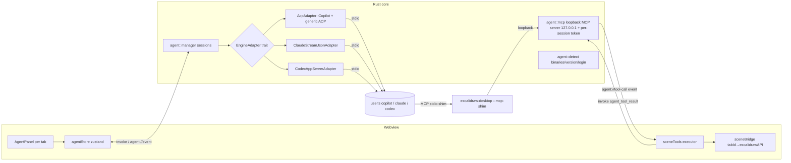

# AI agent integration — "Bring your own agent"

> Design contract for the AI features (requirements §4.9, plan milestones AI-0…AI-6). Status lives in `docs/status.md`.
> The app never holds AI credentials: it drives the user's **locally installed, already signed-in** agent
> (GitHub Copilot CLI, Claude Code, or OpenAI Codex) and exposes the canvas to it as MCP tools.

## Decisions

| #     | Decision                                                                                                                                                                                                                                                                                                                  |
| ----- | ------------------------------------------------------------------------------------------------------------------------------------------------------------------------------------------------------------------------------------------------------------------------------------------------------------------------- |
| D-AI1 | v1 supports **Copilot CLI, Claude Code, and Codex** behind one shared engine layer.                                                                                                                                                                                                                                       |
| D-AI2 | Primary surface: **docked right-side chat panel**. Each drawing keeps a list of conversations; one is active per tab.                                                                                                                                                                                                     |
| D-AI3 | Agent edits **apply live**; each turn is one undoable step, plus a **Revert turn** button.                                                                                                                                                                                                                                |
| D-AI4 | The agent works in a **working folder** (its per-conversation session folder, or an attached one). Writes inside it are auto-approved; shell and anything outside need approval or are blocked. The user can opt in per conversation to **Allow all**, which approves every later request without a card (see Approvals). |
| D-AI5 | Per-engine toggle **"Use my agent's MCPs, skills & plugins"** (default **on**). Tools from those sources that aren't known read-only need in-app approval, with "allow for this conversation".                                                                                                                            |
| D-AI6 | Claude Code is **bring-your-own-binary**. If `claude` is installed and logged in, we use it. We never read, store, or proxy credentials. Settings shows a one-line "your Claude/Copilot/OpenAI terms apply" note, and legal review is a release-gate item (T3 Code ships this same pattern).                              |
| D-AI7 | **No API keys anywhere.** Remove `openAiKey` and migrate it out of `settings.json`. SEC-3 becomes "the app stores no AI credentials".                                                                                                                                                                                     |
| D-AI9 | **Port from T3 Code (MIT), don't embed it.** Engine adapters stay in Rust; we port T3 Code's protocol schemas, engine quirks, PATH discovery, MCP bridge, and replay-fixture test approach. We don't ship its Node/Effect server or its Tailwind UI. See "Reuse from T3 Code".                                            |

## Research summary (what drives the design)

- **Copilot CLI:** `copilot --acp --stdio` is a native ACP server (public preview), with NDJSON JSON-RPC
  (`initialize`, `session/new {cwd, mcpServers}`, `session/prompt`, `session/update`,
  `session/request_permission`, `session/cancel`). Tool filters are set per process:
  `--available-tools` / `--excluded-tools`, `--allow-tool` / `--deny-tool` rules (e.g. a path-scoped
  `write(<dir>/**)`), `--add-dir`, `--disallow-temp-dir`, and `--no-custom-instructions` /
  `--disable-builtin-mcps` when the "my MCPs" toggle is off. The login lives in the OS credential store.
  There is no `auth status` command, so we detect an auth error on the first `session/new`. Each prompt
  uses a premium request. The Copilot SDK (MIT, now has a Rust crate) is an alternative; ACP is simpler
  and doesn't load the runtime in-process.
- **Claude Code:** `claude -p --input-format stream-json --output-format stream-json --verbose` runs a
  long-lived bidirectional session. It also supports `--mcp-config`, `--disallowedTools
Bash,Edit,Write,NotebookEdit`, `--permission-prompt-tool stdio` (approvals arrive as `can_use_tool`
  control requests on the same stream),
  `--append-system-prompt`, and `--resume`. The ACP adapter (`agentclientprotocol/claude-agent-acp`)
  needs Node plus the Agent SDK, so a native stream-json adapter avoids a Node dependency. Strip
  `ANTHROPIC_API_KEY`, `ANTHROPIC_AUTH_TOKEN`, and `CLAUDECODE` from the child env so the user's own
  login is used and billing doesn't switch silently. Deliberate enterprise provider choices are kept:
  `CLAUDE_CODE_OAUTH_TOKEN`, `CLAUDE_CODE_USE_BEDROCK` / `_VERTEX` / `_FOUNDRY`, and
  `ANTHROPIC_BASE_URL`.
- **Codex:** `codex app-server` speaks JSON-RPC over stdio and handles threads and approval requests
  (it is what the Codex IDE extension uses, and what T3 Code uses). It is marked experimental, so we
  pin a minimum version (`codex::CODEX_MIN_VERSION`, 0.156.0). The workspace-write sandbox is set
  three ways: launch `-c sandbox_mode="workspace-write" -c approval_policy="on-request"
-c sandbox_workspace_write.network_access=false`, the thread's `sandbox` + config
  (`sandbox_workspace_write.writable_roots`), and every turn's `sandboxPolicy`
  (`workspaceWrite { writableRoots, networkAccess: false }`). Codex 0.170 removed
  `approval_policy="untrusted"`, so commands run inside that sandbox without asking; only escalations
  (writes outside the roots, network) ask. Our server is added as `mcp_servers.excalidraw` with
  `bearer_token_env_var`, so the token never appears in argv. We strip `OPENAI_API_KEY` and
  `CODEX_API_KEY` so the user's ChatGPT sign-in is used instead of API billing. `codex exec --json`
  is a documented fallback but is not implemented. `codex-acp` also exists.
- **ChatGPT desktop app / Copilot desktop app:** neither exposes an API another app can drive. We say so
  in the UI and docs ("use Codex CLI with your ChatGPT sign-in").
- **Excalidraw 0.18.1:** everything we need is public API: `updateScene({captureUpdate: IMMEDIATELY})`,
  `newElementWith`, `convertToExcalidrawElements`, `restoreElements({repairBindings})`, `exportToBlob`,
  and `hashElementsVersion`. `@excalidraw/mermaid-to-excalidraw` 2.2.2 is already a transitive
  dependency and is CSP-safe (no eval). `TTDDialog onTextSubmit` can be backed by our agent (it returns
  Mermaid, not streamed). Pitfalls: bump element versions, tombstone deletes (or collab won't sync them),
  arrows to _existing_ shapes need manual bindings, block edits in collab **viewer** tabs, and call
  `markDirty` explicitly.

## Reuse from T3 Code

[pingdotgg/t3code](https://github.com/pingdotgg/t3code) (MIT, © 2026 T3 Tools Inc.) already drives all
three engines from a desktop app. Its stack is TypeScript on Effect, in an Electron + Node server, so it
can't be dropped into our Tauri/Rust core. Shipping it as a Node sidecar would add a bundled runtime and
a second process model for little gain, so we **port the following and cite the source**:

| T3 Code source                                                                                | What we take                                                                                                                                                                                                                                                                                                | Lands in                                       |
| --------------------------------------------------------------------------------------------- | ----------------------------------------------------------------------------------------------------------------------------------------------------------------------------------------------------------------------------------------------------------------------------------------------------------- | ---------------------------------------------- |
| `packages/effect-acp` (`_generated` schema)                                                   | The ACP message schema, used to generate Rust `serde` types instead of hand-writing them.                                                                                                                                                                                                                   | `src-tauri/src/agent/acp/`                     |
| `packages/effect-codex-app-server` (`_generated` schema, `scripts/generate.ts`)               | Codex app-server request/notification types, and the generator approach for re-syncing when Codex changes.                                                                                                                                                                                                  | `src-tauri/src/agent/codex/`                   |
| `packages/provider-acp-registry/src/server/{adapter,copilotAcp}.ts`                           | Copilot specifics: detect `copilot`/`copilot.exe`/`copilot.cmd`; Copilot gets our MCP server over **HTTP** (the stdio shim then only serves Claude/Codex); lost-session error markers; `session/prompt` held open while async shells run; `session/new` reporting the wrong model; tool-kind normalization. | Copilot adapter; AI-0 checks each still holds. |
| `apps/server/src/orchestration-v2/Adapters/CodexAdapterV2.ts`                                 | `approvalPolicy` + `sandboxPolicy` combinations per mode, and the `CODEX_HOME` conflict handling.                                                                                                                                                                                                           | Codex adapter                                  |
| `apps/server/src/orchestration-v2/Adapters/ClaudeAdapterV2.ts`                                | Claude event mapping and permission handling. T3 uses the Agent SDK with `pathToClaudeCodeExecutable` (the user's binary); we speak the same stream-json protocol directly from Rust.                                                                                                                       | Claude adapter                                 |
| `apps/server/src/mcp/{AcpMcpStdioBridge,McpHttpServer}.ts`                                    | A verbatim JSON-RPC relay from stdio to an HTTP endpoint with a bearer token, and MCP protocol version `2025-06-18`. Same design as our `--mcp-shim`.                                                                                                                                                       | `--mcp-shim`, MCP server                       |
| `apps/desktop/src/shell/DesktopShellEnvironment.ts`                                           | GUI-app PATH discovery: login shell `-ilc` capture with a timeout, `launchctl getenv PATH` fallback on macOS, Windows profile/no-profile PATH merge, and version-manager variables (fnm/mise).                                                                                                              | `detect`                                       |
| `apps/server/scripts/{acp-mock-agent,record-*-replay-fixture}.ts`, `orchestration-v2/testkit` | A fake ACP agent plus record/replay fixtures per engine for deterministic adapter tests.                                                                                                                                                                                                                    | cargo tests, Playwright fake agent             |
| `apps/web/src/components/ChatView.logic.ts`, `ChatMarkdown.tsx`                               | Timeline/streaming-delta reduction and markdown-rendering logic only. Its components use Tailwind + Base UI, so we rebuild the panel with our tokens and `.icon-btn`/`.modal` classes.                                                                                                                      | `agentStore`, panel                            |

Rules for porting: keep T3 Code's copyright + MIT notice in a header of each ported file and in
`THIRD_PARTY_NOTICES.md`. Copy schemas and logic, not the Effect runtime. Re-verify every engine quirk
against the minimum engine version we pin in AI-0, because T3 Code tracks the newest engine builds.

## Architecture

- **Canonical event model** (the same pattern as T3 Code's `ProviderRuntimeEvent`): `TurnStarted`,
  `TextDelta`, `ThinkingDelta`, `ToolCall{started|updated|completed}`, `PermissionRequest`, `Plan`,
  `TurnEnded{stopReason, usage?}`, `Error{kind: notInstalled|notLoggedIn|orgDisabled|crashed|...}`. Each
  adapter translates its engine's protocol into these events. The webview only sees the canonical events.
- **Canvas tools via MCP served by the app:** an axum `/mcp` (streamable HTTP) on 127.0.0.1 with a
  random port and a per-session bearer token. Not every engine supports HTTP MCP, so we pass all of them
  a **stdio shim**: the app's own binary started with `--mcp-shim` (token in env), which proxies stdio to
  the loopback server. Tool calls are forwarded to the webview executor, which owns the excalidrawAPI.
  Rust waits for the result with a timeout.
- **Process hygiene:** resolve binaries from a candidate list, then the login-shell PATH
  (`$SHELL -lic`) on macOS or `where` + PATHEXT on Windows. Users can override the path. Handle `.cmd`
  shims via `cmd /c` or by resolving the real target. Use `CREATE_NO_WINDOW`; a Windows Job Object
  (kill-on-close) and a POSIX process group plus `killpg` for tree teardown. Send `session/cancel`
  before killing. Each conversation has a stable **session folder** under
  `<appData>/agent/conversations/<conversationId>` (so a resumed session finds its cwd again). The cwd
  is the attached folder if one was attached before the first prompt, otherwise the session folder.
  The **writable roots** are the cwd plus, when a folder is attached mid-conversation, that folder
  (`StartRequest::keep_session_cwd`: the engine restarts and resumes with the session folder still the
  cwd, since Claude and Copilot tie resume to it). Paths are checked with `adapter::resolve_path` /
  `is_within_roots` (canonical, `..` and symlink escapes rejected).
- **Sandboxing per engine** (always on, never `--allow-all*` / `bypassPermissions`, even under Allow all):
  - Copilot: `--allow-tool=write(<root>/**)` per root, `--add-dir=<root>` for roots other than the
    cwd, `--disallow-temp-dir`, `--allow-tool=excalidraw`, `--no-ask-user`. Shell and out-of-root
    writes arrive as ACP `session/request_permission` and become cards; a conversation grant for a
    shell command covers only that exact command.
  - Claude: `--tools` adds `Edit,Write,MultiEdit,NotebookEdit,Bash` to the read-only built-ins,
    `--disallowedTools BashOutput,KillShell,KillBash,PowerShell`, `--add-dir` per extra root,
    `--permission-mode default`, `--permission-prompt-tool stdio`. Our `can_use_tool` handler
    auto-allows write tools whose target is inside a root; Bash (keyed per command) and other writes
    get a card.
  - Codex: the workspace-write sandbox above (writable roots, no network, `/tmp` and `$TMPDIR`
    excluded). File-change approvals are auto-accepted when every path is inside the roots, otherwise
    carded; conversation grants are keyed by the exact file set.
  - Our own canvas tools are pre-approved. Any other permission request becomes an inline approval
    card (Allow once / Allow for this conversation / Allow all for this conversation / Deny). The
    card title is a one-line summary; the command (or tool input) shows once in a scrollable block.
  - **Allow all for this conversation** is opt-in, by clicking it on a card. The session manager
    (`agent/manager.rs` `ApprovalGate`) approves that request and any others waiting, then answers
    every later permission request from the engine itself (shell, writes outside the roots, Codex
    escalations, MCP tool prompts) without showing a card. Engines get a one-time approval on the
    wire (never Codex `acceptForSession` or ACP `allow_always`), so the sandbox and flags above are
    unchanged, and the tool calls still show in the transcript. An `approvalMode` event drives the
    context-bar indicator "Approvals: Allow all", whose Turn off (`agent_set_allow_all`) restores
    cards. It is held in memory only: a new conversation, an engine restart, or a resumed
    conversation starts with it off.
- **"Use my MCPs, skills & plugins" OFF:** Copilot gets `--disable-builtin-mcps`,
  `--no-custom-instructions`, and only our MCP server. Claude gets `--strict-mcp-config`. Codex merges `-c`
  overrides recursively, so `-c mcp_servers={}` would not remove anything: instead we `config/read`
  and set `mcp_servers.<name>.enabled=false` for each user server, and turn off project docs, apps,
  plugins and skill instructions. The global `$CODEX_HOME/AGENTS.md` still applies, because isolating
  `CODEX_HOME` would also lose the user's sign-in.
- **Privacy, CSP and capabilities:** the webview makes **no** new network requests, the CSP is
  **unchanged**, and no new Tauri plugin capability is needed (only custom commands). Network traffic
  comes from the user's agent process, to its own provider, only after the AI master toggle is on, the
  engine is enabled, and the user sends a prompt. The first use per engine shows a disclosure: "Prompts,
  the canvas content the agent reads, and attached-folder files are sent to <provider> under your
  <engine> account." The Playwright privacy test asserts that with AI off, no engine process starts and
  no requests are made.

## Agent tool set (served by our MCP)

Every tool takes an optional `tabId` (default: the active tab). Read tools return a `revision`. Edit
tools accept `expectedRevision` and are rejected if the scene changed since that read.

| Tool                    | What it does                                                                                                    |
| ----------------------- | --------------------------------------------------------------------------------------------------------------- |
| ---------------------   | --------------------------------------------------------------------------------------------------------        |
| `list_tabs`             | Lists open tabs                                                                                                 |
| `get_scene_summary`     | Compact element rows plus bounds, with pagination by bbox, ids, or cursor                                       |
| `get_selection`         | Returns the current selection                                                                                   |
| `get_elements`          | Returns elements by id                                                                                          |
| `render_canvas_png`     | Renders all / viewport / selection as a PNG ≤1280px for the model to look at                                    |
| `add_elements`          | Adds skeleton-format elements; agent-chosen ids are checked for collisions                                      |
| `update_elements`       | Updates elements, limited to an allowlisted set of fields; re-routes bound arrows                               |
| `delete_elements`       | Tombstones elements and cascades to bound text and arrows                                                       |
| `connect`               | Draws an arrow between shapes with manual bindings; `startAnchor`/`endAnchor` pin elbow ends                    |
| `add_mermaid`           | Converts Mermaid via mermaid-to-excalidraw; reports when the result fell back to an image                       |
| `add_image`             | Places a png/jpeg/gif/webp/svg (≤10 MB) from a conversation-folder `path` or inline `data`                      |
| `arrange`               | align / distribute / grid / group / z-order / frame (put into or take out of a frame)                           |
| `set_viewport`          | Moves the viewport, without an undo step                                                                        |
| `find_elements`         | Searches by text or regex, type, color, group, frame and bbox                                                   |
| `select_elements`       | Sets the user's selection (replace/add/remove/clear, optional reveal); no undo step                             |
| `get_canvas_state`      | Viewport rect and zoom, scene bounds, selection, theme, background, grid, current item styles                   |
| `move_elements`         | Moves by dx/dy; labels and frame contents follow, bound arrows re-route                                         |
| `duplicate_elements`    | Copies with labels, frame contents and internal arrows; returns an old → new id map                             |
| `set_canvas`            | Background color (undoable, saved) and grid mode                                                                |
| `apply_extension`       | Applies a desktop extension preset/params (e.g. mask an image to a circle); see `extensions.md`                 |
| `remove_extension`      | Removes an extension and restores the element from its stored source                                            |
| `auto_layout`           | Lays out the canvas or `ids` (layered/tree, direction, spacing) with ELK; re-routes bound arrows                |
| `tidy_arrows`           | Routes bound arrows around other shapes as elbows without moving shapes (`ids`, `convert`); also in `apply_ops` |
| `list_layers`           | Layers tree as flat rows (frames → groups → elements) with names, lock state and depth                          |
| `update_layer`          | Renames and/or locks an element, frame or group by id (works in `apply_ops`)                                    |
| `set_shape_data`        | Sets / removes key/value data on elements (`set`, `replace`) as one undo step (D-DX2)                           |
| `get_shape_data`        | Returns elements' key/value data as JSON or CSV                                                                 |
| `set_arrow_anchors`     | Pins bound elbow-arrow ends to n/e/s/w/center; Excalidraw re-routes them (D-DX8)                                |
| `create_component`      | Turns `ids` (or a group) into a component master (D-DX9, `docs/components.md`)                                  |
| `insert_instance`       | Places an instance of a component (`x`, `y`, `scale`, `angle` in degrees)                                       |
| `list_components`       | Masters and instances with slots and overrides; no undo step                                                    |
| `list_my_components`    | The personal My components library (id, name, element and image counts); no tab, no undo step                   |
| `insert_my_component`   | Places a My components entry by id or name (with its images) as a library-backed instance; one undo step        |
| `set_overrides`         | Per-slot instance overrides: text, colours, opacity, link, image (`null` clears)                                |
| `reset_overrides`       | Clears an instance's overrides (all, or some slots/keys)                                                        |
| `detach_instance`       | Turns an instance into plain elements that keep their look                                                      |
| `create_container`      | Makes a stack container from elements (direction, gap, padding, align, sizing)                                  |
| `update_container`      | Changes a container's settings and/or child `order`                                                             |
| `remove_container`      | Dissolves a container; `keepBox` keeps a plain group with its box                                               |
| `add_to_container`      | Moves elements into a container, optionally at `index`                                                          |
| `remove_from_container` | Takes elements out of their container                                                                           |
| `list_containers`       | Lists containers with their settings and ordered children                                                       |
| `list_styles`           | Named styles with props and linked element ids; no undo step (FR-58, `docs/styles.md`)                          |
| `create_style`          | New style from `ids` (their look, or `props`), linked to them                                                   |
| `apply_style`           | Links `ids` to a style (dropping their overrides); `null` unlinks                                               |
| `update_style`          | Renames and/or changes a style's props (`null` removes one); linked elements follow                             |
| `delete_style`          | Deletes a style; its elements are unlinked and keep their look                                                  |
| `reset_style_overrides` | Clears elements' local style overrides (all, or some `keys`)                                                    |
| `apply_ops`             | Batches several edits into one undo step                                                                        |
| `approve`               | Internal fallback for engines that route approvals through MCP; handled in Rust, not the webview                |

A system prompt (appended) explains the coordinate system, the tool workflow (summary, then render,
then edit), and the style defaults.

**`add_image` and files.** `add_image` takes either `path` or `data` + `mimeType`, plus optional
`x`/`y`, `width`/`height` (the aspect ratio is kept when only one is given; the default is the image's
own size, capped at 400px), and `inside` (a card, shape or frame id to fit the image into, with
`padding`; a frame also adopts it). It returns the new element id and `fileId`. A `path` never reaches
the webview. The MCP server (`src-tauri/src/agent/mcp/images.rs`) resolves it against the
conversation's file roots: the writable roots (the cwd and an attached folder) plus the session
folder. Relative paths resolve against the cwd. The server rejects `~`, traversal, and symlinks that
escape after canonicalization. It then reads at most 10 MB, sniffs the magic bytes, and forwards the
call with base64 `data` instead. This also applies to `add_image` ops inside `apply_ops`. The webview
(`src/agent/scene/images.ts`) re-checks the cap and the magic bytes against the declared type. It
rejects SVG that has `<script>`, `<foreignObject>`, `on*` handlers, external `href`/`url()`, or
`@import`. It then registers the file via `addFiles`. There are no URL downloads, no new Tauri
command or capability, and no CSP change: `img-src` already allows `data:`. Image guidance lives in
the `add_image` tool description, not the system prompt: image bytes returned by another tool go
straight to `add_image` as `data`, so they don't get echoed or stored and inflate the context.

## UX

- **Settings → AI** replaces the OpenAI section:
  - Master toggle, default off.
  - One card per engine showing detected path and version and login state, with "Re-detect", "Custom
    path…", a copyable "How to sign in" command (`copilot login` / `claude` then `/login` /
    `codex login`), an Enable checkbox, the "Use my MCPs, skills & plugins" toggle, and a default model
    (when the engine reports a model list).
  - Default engine.
  - A terms note.
- **Agent panel**, toggled from the toolbar button, View → AI Panel, or ⌘/Ctrl+Shift+A:
  - Docked right, resizable, one panel per tab. The header title is a **conversation menu**: New
    conversation, plus this drawing's earlier conversations (title, engine, last used) to reopen or
    delete.
  - A context bar under the header shows the active conversation's **Engine**, **Model** and
    **Folder**. The engine and folder can be picked only before the first prompt, then they're fixed
    (start a new conversation to change them). The model picker lists what the engine reports
    (Copilot `configOptions`/`models`, Codex `model/list`, Claude `init.models`, cached per engine so
    it's available before a session starts). It stays switchable mid-conversation on Copilot
    (`session/set_config_option`) and Codex (per-turn `model`), and is fixed after the first prompt on
    Claude. The Settings model is the default for new conversations. Folder shows "Session folder"
    (the agent's own per-conversation folder, where files it writes land) or the attached folder's
    name (full path on hover), with Reveal. Before the first prompt it offers Attach / Change /
    Detach; afterwards only Attach, and only while no folder is set and no turn is running. Attaching
    then restarts the engine and resumes the same conversation (`folderAttachedLate` is persisted).
  - The transcript renders GitHub-flavored Markdown (react-markdown + remark-gfm: tables, fenced
    code, task lists; raw HTML escaped, images shown as alt text, only http(s) links), collapsible
    "thinking", and each run of consecutive tool calls folded into one collapsible "N tool calls"
    group in the flow.
  - Inline approval cards, a Stop button, and **Revert turn** on each completed turn.
  - Context chips: auto "Selection (n)" and "Snapshot" to send a render.
  - Quick actions on empty state: _Diagram from description_, _Explain selection_, _Tidy layout_,
    _Convert to Mermaid_, _Diagram this folder_ (needs Attach).
  - Empty and error states for each failure: not installed (with link to install docs), not logged in,
    org disabled, engine crashed (Retry), and a viewer tab in a live session (agent disabled).
- **Revert turn:** at turn start we snapshot the versions of every element the turn touches. Revert
  writes them back with bumped versions and tombstones anything the turn added, in one undoable,
  collab-safe `updateScene`. It is available only until the user edits those same elements (otherwise
  a "conflicts with later edits" confirmation appears).
- **Excalidraw's own TTD dialog:** render `<TTDDialog onTextSubmit>` and route it through the default
  engine with a "return Mermaid only" prompt. The built-in "Text to diagram…" then works too.
- **Persistence (hybrid):** the engine keeps the real context; the app keeps a small index per drawing
  in `agent-conversations.json` (`src/agent/conversationStore.ts`), keyed by file path (or `tab:<id>`
  for untitled drawings, migrated on first save and dropped when an untitled tab closes). Each record
  holds the title, engine, engine session id, model, folder, usage and a trimmed transcript (last 300
  items, long tool output truncated); at most 50 conversations per drawing. Reopening a conversation
  shows its transcript and resumes the engine session on the next prompt (`session/load` /
  `--resume` / thread resume). Nothing is read or written while AI is off, and nothing goes into the
  `.excalidraw` file.
- **Engine notices:** Copilot prints CLI notices (e.g. "Info: Disabled tools: …") as
  `agent_message_chunk`s without a `messageId`; the adapter logs and drops them instead of showing
  them as assistant text. Excluded tool names are limited to ones the CLI knows.
- **Collab:** a host's agent edits sync like local edits, and the panel shows "Edits are shared with N
  participants". Agent tools refuse to run in a viewer tab. Browser guests have no agent.

## Testing

- **Vitest:**
  - sceneTools: summary compaction, version bumps, tombstones, connect bindings, revert, revision
    conflicts, viewer guard.
  - agentStore reducer over canonical events.
  - Panel components.
  - Settings migration.
- **cargo test:**
  - detect, using fake binaries on a temp PATH and Windows `.cmd` handling.
  - Each adapter's translation, using recorded fixtures.
  - MCP server auth (a wrong token gets 401) and per-session token isolation.
  - Kill-tree.
  - Argument builders, asserting the sandbox flags are always present and never use engine allow-all / bypass modes.
  - In-root writes auto-approved, out-of-root writes and shell carded (per adapter), path resolution
    escapes (`..`, symlinks, sibling prefixes, `~`).
  - Live (ignored, `cargo test --lib commands::agent::live_tests -- --ignored`): `live_*_writes`
    asks each engine to create `hello.txt` and checks it lands in the session folder with no card.
- **Playwright:**
  - With AI off, no `agent_*` invoke and zero requests.
  - A panel flow against the fake ACP agent (which emits tool calls that draw a box), then undo and
    revert.

## Risks

| Risk                                                                     | Mitigation                                                                                                             |
| ------------------------------------------------------------------------ | ---------------------------------------------------------------------------------------------------------------------- |
| Preview or experimental protocols change (Copilot ACP, Codex app-server) | Pin minimum versions, a capability probe at detect time, fixture tests, and a generic-ACP fallback.                    |
| Terms of service (especially Claude)                                     | BYO binary only, never touch credentials, terms note in Settings, and legal review as a release gate.                  |
| User MCPs and plugins act outside the canvas                             | Toggle per engine, approval cards, built-in shell and write tools always off.                                          |
| Large scenes bloat the context window                                    | Compact summaries, pagination, and rendered PNGs.                                                                      |
| Quota and cost surprise                                                  | Show "uses your <engine> plan / premium requests" in the panel footer, plus usage per turn when the engine reports it. |
| GUI app PATH on macOS; `.cmd` shims on Windows                           | Explicit probing, login-shell PATH, custom path override.                                                              |

## Sources

- T3 Code (MIT), reference implementation for all three engines: https://github.com/pingdotgg/t3code
- Copilot CLI ACP server: https://docs.github.com/en/copilot/reference/copilot-cli-reference/acp-server
- Copilot CLI programmatic reference: https://docs.github.com/en/copilot/reference/copilot-cli-reference/cli-programmatic-reference
- Copilot SDK: https://github.com/github/copilot-sdk
- Agent Client Protocol + agent list: https://agentclientprotocol.com/get-started/agents
- Claude Code legal & compliance: https://code.claude.com/docs/en/legal-and-compliance
- Claude ACP adapter: https://github.com/agentclientprotocol/claude-agent-acp
- Codex auth: https://developers.openai.com/codex/auth
- Codex app-server: https://github.com/openai/codex/blob/main/codex-rs/app-server/README.md
- Codex ACP adapter: https://github.com/agentclientprotocol/codex-acp
- Prior art (BYO Claude/Codex login): https://github.com/pingdotgg/t3code

Flags and wire names marked in the research as unverified are confirmed during AI-0 spikes; fixtures recorded there become the adapter tests.
